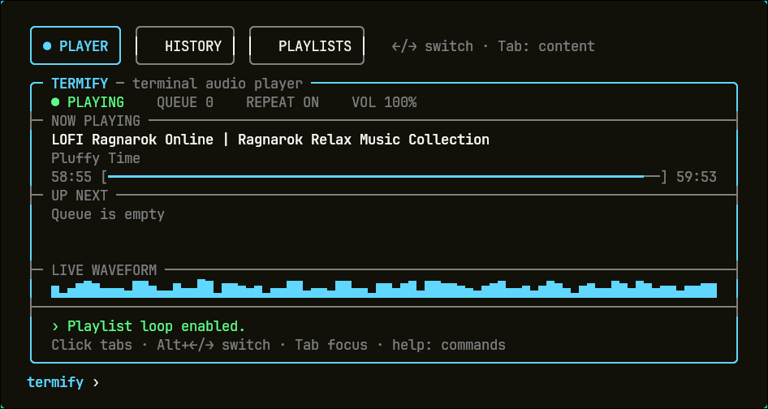

<p align="center">
  
</p>

<h1 align="center">Termify</h1>

<p align="center">
  <a href="https://github.com/segfaultcafe/Termify/actions/workflows/ci.yml"></a>
</p>

<p align="center">
  A focused terminal audio player for Linux, built with modern C++, FFmpeg,
  ALSA, and an included standalone yt-dlp.
</p>

## Highlights

- Search for music, paste a supported URL, or play a local audio file
- Responsive, centered terminal interface with a live waveform
- Title, artist, album, elapsed time, duration, and playback progress
- Bounded 20-track queue with one-at-a-time background prefetching
- Selectable upcoming tracks with play-now activation and precise CLI editing
- Player, History, Playlists, and YouTube Search tabs with keyboard and mouse
  controls
- Clickable playback controls, a track-repeat toggle, and a mouse-wheel
  volume dial
- Mouse seeking by clicking or dragging the progress bar, plus precise CLI
  seeking while playing or paused
- Persistent playlists built from previously heard cached tracks or verified
  YouTube Search results
- Local play history and a bounded audio cache for replaying downloaded tracks
- Pause, resume, skip, repeat, stop, and software volume control
- Editable Unicode-aware input with cursor movement and deletion
- Clean cancellation, temporary-file cleanup, and readable error messages
- Self-contained online fetching: no Python or separate yt-dlp installation

**v0.4.0** adds clickable Player controls, a navigable YouTube Search tab with
cached results and playlist actions, and symmetric Play Now and Play Next
controls in History. Mouse-driven playback remains fully compatible with the
command prompt.

**v0.5.0** adds progress-bar and CLI seeking, remembers
volume between sessions, shows resolved song titles in **UP NEXT**, and keeps a
looping playlist's queue visibly continuous between cycles.

The in-development **v0.6.1** makes **UP NEXT** selectable for immediate
playback and adds precise `queue` editing commands. Queue edits affect only the
current playback session; saved playlist order remains unchanged. The Player's
existing help row remains uncluttered.

**v0.3.1** fixes playlist advancement with `next`, preserves playlist loops,
and prioritizes manually queued tracks without ending the playlist session.

The latest packaged release is **v0.5.0**.

## Install the Linux release

Download `termify-v0.5.0-linux-x86_64.tar.gz` and its checksum from the
[v0.5.0 GitHub release](https://github.com/segfaultcafe/Termify/releases/tag/v0.5.0).

```bash
sha256sum -c termify-v0.5.0-linux-x86_64.tar.gz.sha256
tar -xzf termify-v0.5.0-linux-x86_64.tar.gz
cd termify-v0.5.0-linux-x86_64
./install.sh
```

The installer places `termify` in `~/.local/bin` by default. You can also pass
an installation prefix explicitly. For a system-wide installation:

```bash
sudo ./install.sh /usr/local
```

The archive includes the official standalone `yt-dlp` 2026.10.26 executable.
The installer normally keeps it private in `~/.local/lib/termify`, so it does
not replace or interfere with a system installation. If that directory is not
writable, it safely falls back to placing yt-dlp beside the Termify executable.
Python and a separate yt-dlp install are not required.

### Distribution setup

Termify uses FFmpeg libraries for decoding, ALSA for audio output, and SQLite
for local storage. Install those runtime dependencies before running the
release. The archive is not yet a universal Linux binary; check the ABI
compatibility note below before installing.

**Arch Linux / Manjaro**

```bash
sudo pacman -S ffmpeg alsa-lib sqlite
```

**Fedora**

```bash
sudo dnf install ffmpeg-free alsa-lib sqlite-libs
```

**Debian / Ubuntu / Linux Mint**

```bash
sudo apt update
sudo apt install ffmpeg libasound2 libsqlite3-0
```

On Debian 13 and newer, `libasound2` may be provided by `libasound2t64` and is
normally selected automatically.

**openSUSE**

```bash
sudo zypper install ffmpeg libasound2 libsqlite3-0
```

Then use the same checksum, extraction, and `./install.sh` commands shown
above. The v0.5.0 prebuilt binary is produced on x86_64 Arch Linux and expects
FFmpeg 9 ABI libraries (`libavformat.so.63`, `libavcodec.so.63`,
`libavutil.so.61`, and `libswresample.so.7`), plus `libsqlite3.so.0` and
`libasound.so.2`. It is tested on the build host, not certified across all
distributions. On distributions with an older FFmpeg ABI, use the source-build
instructions below; the build
will link against that distribution's native FFmpeg version.

Alpine uses musl rather than glibc, and NixOS does not expose system libraries
through the standard filesystem layout. For those systems, build from source
inside the native package environment instead of using this glibc archive.

## Bundled online playback

Online search and URL playback work immediately with the yt-dlp included in the
release. Termify checks its private bundled copy automatically. To test it from
an extracted archive:

```bash
./yt-dlp --version
```

Advanced users can override the bundled executable without modifying Termify:

```bash
TERMIFY_YTDLP=/absolute/path/to/another/yt-dlp termify
```

## Quick start

Start the interface:

```bash
termify
```

Then enter commands at the `termify ›` prompt:

| Command | Description |
| --- | --- |
| `play <name, URL, or file>` | Play if idle, otherwise queue the track next |
| `pause` / `resume` | Pause or resume the current track |
| `next` | Skip to the next queued track |
| `seek 1:30` | Seek to an absolute position (`SS`, `MM:SS`, or `HH:MM:SS`) |
| `seek +10` / `seek -0:30` | Seek forward or backward relative to the current position |
| `repeat` | Toggle repeating the current track |
| `volume 60` | Set volume from 0 to 100 percent |
| `volume +10` / `volume -10` | Adjust volume relative to its current level |
| `queue` | Show the number of queued tracks |
| `queue play N` | Play queued position N now |
| `queue remove N` | Remove queued position N from this session |
| `queue move N up` / `queue move N down` | Reorder a track within its priority tier |
| `queue clear` | Clear upcoming tracks (CLI form) |
| `history` / `player` | Switch to the History or Player tab |
| `playlists` | Open the playlist manager |
| `search` | Open the YouTube Search tab |
| `clear` | Clear upcoming tracks |
| `stop` | Stop playback and clear the queue |
| `help` | Show the interactive command list |
| `help <command>` | Show focused usage, such as `help volume` |
| `exit` | Leave Termify cleanly |

Examples:

```text
play daft punk veridis quo
play https://www.youtube.com/watch?v=...
play /home/me/Music/song.flac
volume 65
seek 1:30
seek -15
next
```

### Navigate the interface

- The Player tab's **NOW PLAYING** divider has clearly labeled ASCII controls
  for **PLAY/PAUSE**, **NEXT**, and **STOP**. The first button changes from
  `|> PLAY` to `|| PAUSE` with playback state. Click one, or reach it with Tab
  and activate it with Enter or Space. The command prompt remains available
  for adding new songs.
- The Player summary has a rotating **VOL** dial. Hover it and use the mouse
  wheel in 5% steps, or focus it with Tab and use the arrow keys. The adjacent
  **REPEAT ON/OFF** button toggles repeating only the current track. The last
  volume setting is restored the next time Termify starts.
- Click or drag anywhere on the playback progress bar to seek. Hover the bar
  and use the mouse wheel to move backward or forward in five-second steps.
  Seeking also works while paused. Termify clamps requests at the beginning
  and end of the track; no new keyboard shortcut is assigned.
- The bordered file-style tabs sit above the player. A cyan dot marks the
  active view; hovering highlights a tab without taking focus from your typing.
- The **QUIT** button in the player frame's title bar stops playback, clears
  pending work, and closes Termify through the same clean shutdown path as the
  `quit` command.
- The frame title shows the build version, for example
  `TERMIFY - terminal audio player - v0.6.1`.
- Use **Alt+Left / Alt+Right** or click a tab to switch views.
- **Tab / Shift+Tab** cycles focus. Left/right arrows switch tabs when the tab
  bar is focused; **Esc** returns to the command prompt.
- In History, use **Up / Down**, **Page Up / Page Down**, or **Home / End** to
  select a play. The mouse wheel scrolls and a click selects a row.
- Press **Enter** on a selected history row to queue that song again. The
  `history` command opens the tab and focuses the list directly.
- History mirrors the Search action row: select a previous play and choose
  **PLAY NOW**, **PLAY NEXT**, or **ADD TO PLAYLIST**. The actions stay hidden
  while History is empty. Double-clicking a History row performs **PLAY NOW**;
  Enter keeps its **PLAY NEXT** behavior. Double-clicking a Search result also
  performs **PLAY NOW**.
- In History, choose **ADD TO PLAYLIST** (or press **A** while the list is
  focused) to add the selected cached play to the playlist last selected in
  the Playlists tab.
- In Search, type a query into the dedicated search box and press Enter.
  Termify returns up to 10 verified YouTube results and keeps recent searches
  in a bounded, session-only cache for 30 minutes.
- Results are numbered in the same order used by keyboard navigation. Select a
  result and choose **PLAY NOW**, **PLAY NEXT**, or **ADD TO PLAYLIST**. Play
  Now interrupts only the current track and then resumes the existing queue or
  playlist. Play Next moves an existing duplicate forward instead of
  enqueuing it twice. These actions stay hidden until a search returns at
  least one selectable result.
- **ADD TO PLAYLIST** opens a compact playlist picker. A `✓` marks playlists
  that already contain the result and confirms additions without closing the
  picker. Choose **NEW PLAYLIST** to name one inline; Termify creates it and
  adds the pending result without leaving Search.
- The Player's **ADD TO PLAYLIST** button opens the same picker for the current
  track, including the inline **NEW PLAYLIST** flow. Cached/history eligibility
  is still enforced before the current track can be saved.
- **UP NEXT** is a selectable three-row list. Double-clicking or pressing
  Enter plays the selected track now. Use `queue remove N`, `queue move N
  up|down`, or `queue clear` for precise queue editing without replacing the
  Player's compact help row. Moving tracks preserves manual Play Next priority
  over playlist tracks, and edits never rewrite the saved playlist.
- The Playlists tab has separate playlist and track lists. Click a row or use
  the arrow keys. **PLAYLIST COMMANDS** groups **NEW**, **RENAME**, and
  **DELETE** with **PLAY SELECTED**, **SHUFFLE**, and **LOOP**; **TRACK
  COMMANDS** groups **ADD CURRENT**, **REMOVE**, and **MOVE UP/DOWN**. Use
  Tab/Shift+Tab to reach every action. Enter or Space activates a focused
  button.
- New and renamed playlist names are entered at the bottom prompt; Escape
  cancels the naming prompt. Deletion requires activating **DELETE** twice.
- The interactive layout requires a terminal of at least **68 × 20** cells.

### Local history and cache

Termify keeps the latest **1,000 plays** in an embedded SQLite database. A play
is recorded when audio first reaches the output device, not when a download
starts. Repeated plays are separate entries, newest first. History survives
restarts. Volume also survives restarts; queued tracks and playback position
do not yet persist.

Online tracks are prefetched and kept in a **256 MiB** disk cache. Reusing the
same search text or URL—including replaying a history entry—avoids another
download while that audio remains cached. `[cache]` marks available cached
audio in History. Different searches for the same song are separate cache
keys. Least-recently-used files are evicted first, but queued or playing files
are protected. Oversized tracks or a cache full of protected files use temporary
downloads, removed after use. Local files are played in place, never copied or
deleted by the cache.

The **UP NEXT** list prefers the song title carried by Search, History, a
playlist, or downloaded provider metadata. It falls back to the canonical URL
only when no title can be resolved; local files fall back to their filename.

Default storage locations:

| Data | Location |
| --- | --- |
| History and cache index | `~/.local/share/termify/library.sqlite3` |
| Downloaded audio | `~/.cache/termify/audio/` |

Absolute `XDG_DATA_HOME` and `XDG_CACHE_HOME` values override these base
directories. SQLite runs inside Termify: no database server, SQLite command-line
tool, Python, or account is required. If storage cannot be opened, playback
continues without persistence and the interface reports the problem.

### Playlists

Playlists contain up to **20** tracks so playing one remains within Termify's
bounded queue. A track can be added only after it has reached audio output,
appears in History, and still has a valid cache entry. Termify stores a SHA-256
identity for yt-dlp's canonical media URL plus its embedded title, artist,
album, and duration. It never treats a newly typed search phrase as playlist
truth and never copies audio into a playlist.

**SHUFFLE** randomizes the order each time the playlist starts and for every
new loop. **LOOP** repeats the whole playlist independently of the `repeat`
command for one track. Its queue is displayed as `∞` and keeps the next three
logical tracks populated across cycle boundaries instead of briefly appearing
empty. Switching **LOOP** off while that playlist is active immediately removes
buffered future-cycle entries without interrupting the current track; any
remaining original-cycle tracks continue normally.
Starting a playlist disables single-track repeat.
Tracks added with `play` while a playlist is active are inserted ahead of the
remaining playlist tracks without ending the playlist session. Multiple manual
additions retain their enqueue order.
Removing a track or deleting a playlist does not delete cached audio. If a
cache entry is later evicted, the saved canonical URL lets Termify fetch it
again when the playlist is played.

## Build from source

Requirements:

- Linux with PipeWire or an ALSA-compatible playback device
- CMake 3.16 or newer
- A C++23-capable compiler
- `pkg-config`
- FFmpeg development libraries: `libavformat`, `libavcodec`, `libavutil`, and
  `libswresample`
- ALSA development libraries
- SQLite3 development libraries (no database service is needed)
- `curl` and `sha256sum` to fetch and verify the bundled downloader

```bash
git clone https://github.com/segfaultcafe/Termify.git
cd Termify
make build
make run
```

`make build` compiles the Debug target and runs the tests. Other useful targets:

```bash
make test       # rebuild and run the test suite
make package    # create the tested Linux release archive and checksum
make install    # build, test, and install to /usr/local/bin
```

`make build` and `make package` use the same pinned official standalone yt-dlp
release and verify its SHA-256 digest. The first build downloads it into the
project cache; subsequent builds reuse the verified copy without network access.
Python and a separate yt-dlp installation are not required. The build reports
the bundled downloader version so an outdated copy is easy to spot.

The terminal interface is composed from reusable, keyboard- and mouse-aware
widgets. See [docs/TUI.md](docs/TUI.md) before adding or changing interface
components.

## Platform status

Termify currently supports Linux. Windows support is planned around a
cross-platform audio backend and platform-specific terminal and process
adapters; the decoder, queue, metadata, progress, and playback state are
already portable.

The supported-release goals and milestones are tracked in
[ROADMAP.md](ROADMAP.md).

## Contributing

Contributions are welcome. See [CONTRIBUTING.md](CONTRIBUTING.md) for the
development setup, code style, testing expectations, and pull-request process.

## License

[MIT](LICENSE)
