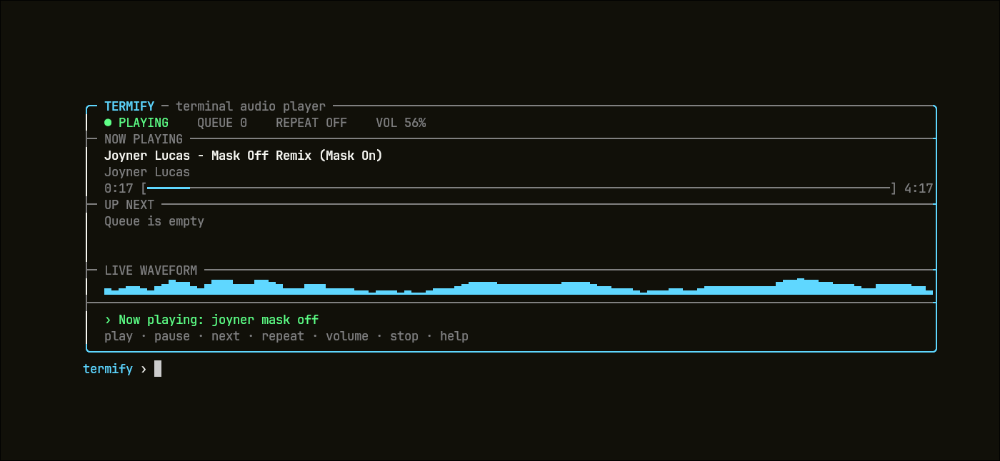

<p align="center">
  
</p>

<h1 align="center">Termify</h1>

<p align="center">
  A focused terminal audio player for Linux, built with modern C++, FFmpeg,
  ALSA, and an included standalone yt-dlp.
</p>

## Highlights

- Search for music, paste a supported URL, or play a local audio file
- Responsive, centered terminal interface with a live waveform
- Title, artist, album, elapsed time, duration, and playback progress
- Bounded 20-track queue with one-at-a-time background prefetching
- Pause, resume, skip, repeat, stop, and software volume control
- Editable Unicode-aware input with cursor movement and deletion
- Clean cancellation, temporary-file cleanup, and readable error messages
- Self-contained online fetching: no Python or separate yt-dlp installation

## Install the Linux release

Download `termify-v0.2.0-linux-x86_64.tar.gz` and its checksum from the
[v0.2.0 GitHub release](https://github.com/segfaultcafe/Termify/releases/tag/v0.2.0).

```bash
sha256sum -c termify-v0.2.0-linux-x86_64.tar.gz.sha256
tar -xzf termify-v0.2.0-linux-x86_64.tar.gz
cd termify-v0.2.0-linux-x86_64
./install.sh
```

The installer places `termify` in `~/.local/bin` by default. You can also pass
an installation prefix explicitly. For a system-wide installation:

```bash
sudo ./install.sh /usr/local
```

The archive includes the official standalone `yt-dlp` 2026.10.26 executable.
The installer normally keeps it private in `~/.local/lib/termify`, so it does
not replace or interfere with a system installation. If that directory is not
writable, it safely falls back to placing yt-dlp beside the Termify executable.
Python and a separate yt-dlp install are not required.

### Distribution setup

Termify uses FFmpeg libraries for decoding and ALSA for audio output. Install
those runtime dependencies before running the release:

**Arch Linux / Manjaro**

```bash
sudo pacman -S ffmpeg alsa-lib
```

**Fedora**

```bash
sudo dnf install ffmpeg-free alsa-lib
```

**Debian / Ubuntu / Linux Mint**

```bash
sudo apt update
sudo apt install ffmpeg libasound2
```

On Debian 13 and newer, `libasound2` may be provided by `libasound2t64` and is
normally selected automatically.

**openSUSE**

```bash
sudo zypper install ffmpeg libasound2
```

Then use the same checksum, extraction, and `./install.sh` commands shown
above. The v0.2.0 prebuilt binary is produced on x86_64 Arch Linux and expects
FFmpeg 9 ABI libraries (`libavformat.so.63`, `libavcodec.so.63`,
`libavutil.so.61`, and `libswresample.so.7`). It is directly compatible with
current rolling distributions that provide those libraries. On distributions
with an older FFmpeg ABI, use the source-build instructions below; the build
will link against that distribution's native FFmpeg version.

Alpine uses musl rather than glibc, and NixOS does not expose system libraries
through the standard filesystem layout. For those systems, build from source
inside the native package environment instead of using this glibc archive.

## Bundled online playback

Online search and URL playback work immediately with the yt-dlp included in the
release. Termify checks its private bundled copy automatically. To test it from
an extracted archive:

```bash
./yt-dlp --version
```

Advanced users can override the bundled executable without modifying Termify:

```bash
TERMIFY_YTDLP=/absolute/path/to/another/yt-dlp termify
```

## Quick start

Start the interface:

```bash
termify
```

Then enter commands at the `termify ›` prompt:

| Command | Description |
| --- | --- |
| `play <name, URL, or file>` | Add a track and start playback |
| `pause` / `resume` | Pause or resume the current track |
| `next` | Skip to the next queued track |
| `repeat` | Toggle repeating the current track |
| `volume 60` | Set volume from 0 to 100 percent |
| `volume +10` / `volume -10` | Adjust volume relative to its current level |
| `queue` | Show the number of queued tracks |
| `clear` | Clear upcoming tracks |
| `stop` | Stop playback and clear the queue |
| `help` | Show the interactive command list |
| `help <command>` | Show focused usage, such as `help volume` |
| `exit` | Leave Termify cleanly |

Examples:

```text
play daft punk veridis quo
play https://www.youtube.com/watch?v=...
play /home/me/Music/song.flac
volume 65
next
```

Queued online tracks are prefetched for the current session. Downloads are
removed after playback or when the queue is cleared.

## Build from source

Requirements:

- Linux with PipeWire or an ALSA-compatible playback device
- CMake 3.16 or newer
- A C++23-capable compiler
- `pkg-config`
- FFmpeg development libraries: `libavformat`, `libavcodec`, `libavutil`, and
  `libswresample`
- ALSA development libraries
- `curl` and `sha256sum` to fetch and verify the bundled downloader

```bash
git clone https://github.com/segfaultcafe/Termify.git
cd Termify
make build
make run
```

`make build` compiles the Debug target and runs the tests. Other useful targets:

```bash
make test       # rebuild and run the test suite
make package    # create the tested Linux release archive and checksum
make install    # build, test, and install to /usr/local/bin
```

`make build` and `make package` use the same pinned official standalone yt-dlp
release and verify its SHA-256 digest. The first build downloads it into the
project cache; subsequent builds reuse the verified copy without network access.
Python and a separate yt-dlp installation are not required. The build reports
the bundled downloader version so an outdated copy is easy to spot.

The terminal interface is composed from reusable, keyboard- and mouse-aware
widgets. See [docs/TUI.md](docs/TUI.md) before adding or changing interface
components.

## Platform status

Termify currently supports Linux. Windows support is planned around a
cross-platform audio backend and platform-specific terminal and process
adapters; the decoder, queue, metadata, progress, and playback state are
already portable.

The supported-release goals and milestones are tracked in
[ROADMAP.md](ROADMAP.md).

## License

[MIT](LICENSE)
